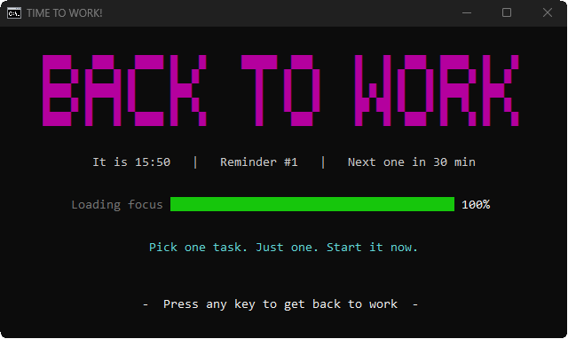
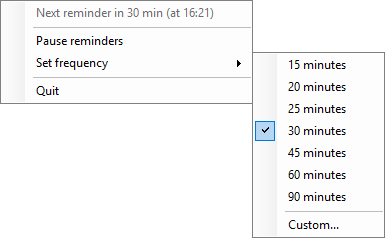

# Work Reminder

Runs in the background with a tray icon and opens an animated "BACK TO WORK"
console window every N minutes (default 30). No other window.

## Screenshots
The reminder popup (the banner flashes through colours, with a soft chime):

The tray menu:

## Tray icon (left or right click)
Teal clock = running, grey pause = paused.
- Status line - when the next reminder comes
- Pause / Resume reminders - resume carries on where it stopped
- Set frequency - 15 to 90 minutes, or Custom (1-480); countdown restarts
- Quit

## Files you can double-click
- `start.bat` - start it (or `start.bat 45` for every 45 minutes).
  Starting twice is harmless; only one copy runs.
- `set-frequency.bat` - same as the tray menu; picked up within 5 seconds.
- `stop.bat` - force stop. Prefer tray > Quit; after `stop.bat` the icon may
  stay in the tray until you move the mouse over it.

The popup closes on any key, or by itself 10 minutes after it opens.
The background program keeps running until you use `stop.bat` or log off.

Sound: a quiet two-note bell (`chime.wav`). To change the volume, edit
`$ChimeVolume` near the top of `popup.ps1` (0 = silent), then delete
`chime.wav` so it is made again.

## Start with Windows
1. Press Win+R, type `shell:startup`, press Enter.
2. Right-click > New > Shortcut. For the location, paste (change the path to
   where you put this folder):
   `conhost.exe --headless powershell.exe -NoProfile -STA -ExecutionPolicy Bypass -File "C:\Work\work-reminder\scheduler.ps1"`
3. Name it `Work Reminder`.

Delete that shortcut to stop it starting with Windows.

## Requirements
Windows 10/11. Uses the built-in Windows PowerShell 5.1; nothing to install.
`config.txt` and `chime.wav` are created on first run.

## Files
- `start.bat`, `set-frequency.bat`, `stop.bat` - controls
- `scheduler.ps1` - hidden background loop
- `popup.ps1` - the animated reminder
- `config.txt` - current frequency in minutes
- `chime.wav` - reminder sound
